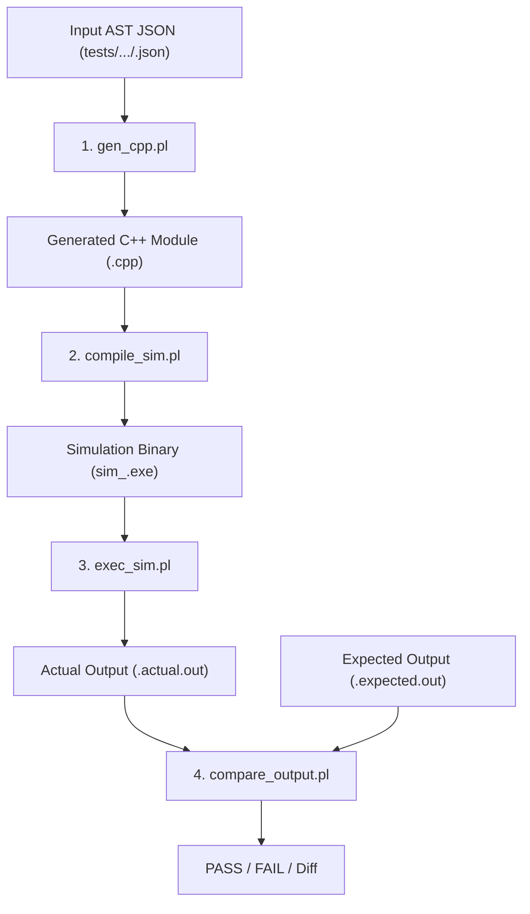

# Test Pipeline Architecture & Execution Guide

This document describes the modular test and simulation verification pipeline for `json2cpp`.

---

## 1. Pipeline Overview

The test pipeline is split into **4 modular Perl scripts**, orchestrated by the master script **`run_tests.pl`**:



---

## 2. Script Responsibilities

| Script | Purpose | Input | Output |
| :--- | :--- | :--- | :--- |
| **`compile.pl`** | Compiles the compiler tools (`libjson2map.a` and `json2verif.exe`). | Source files in `json2cpp_cpp`, `json2map_cpp`, `json2verif_cpp` | `json2verif.exe` |
| **`gen_cpp.pl`** | Runs `json2verif.exe` to parse the test AST JSON and emit the C++ hardware module. | `<test>.json` | `<test>.cpp` |
| **`compile_sim.pl`** | Generates a testbench harness (`sim_runner.cpp`) that instantiates the module class with `main()`, then compiles it with GCC and `primitive_cpp/definitions.cpp`. | `<test>.cpp` | `sim_<test>.exe` |
| **`exec_sim.pl`** | Executes `sim_<test>.exe` and redirects console stdout/stderr to `<test>.actual.out`. | `sim_<test>.exe` | `<test>.actual.out` |
| **`compare_output.pl`** | Compares `<test>.actual.out` against `<test>.expected.out` using pure-Perl line comparison (ignoring CRLF/LF line ending differences). Also supports recording with `--record`. | `.actual.out` & `.expected.out` | `[PASS]` or `[FAIL]` (with mismatch diff) |
| **`run_tests.pl`** | **Master Runner**: Orchestrates stages 1 through 4 sequentially. Supports running a single test or batch regression on `all`. | `<test_name>` or `all` | Full pipeline execution summary |

---

## 3. How to Run

### Step 0: Ensure `json2verif.exe` is built
```powershell
perl compile.pl
```

### Running the Full Flow with Master Runner (`run_tests.pl`)

1. **Record the baseline expected output for a test**:
   ```powershell
   perl run_tests.pl --record test_3_3_1
   ```
   *Executes Stages 1–3 and records the simulation output into `tests/.../test_3_3_1.expected.out`.*

2. **Run verification on a single test**:
   ```powershell
   perl run_tests.pl test_3_3_1
   ```
   *Runs Stages 1–4 and prints `[PASS]` or line-by-line mismatch diff.*

3. **Run regression on ALL tests across the repository**:
   ```powershell
   perl run_tests.pl all
   ```

---

## 4. Running Individual Stages Independently

Each stage can also be run standalone for targeted debugging:

```powershell
# Stage 1: Only generate the C++ file
perl gen_cpp.pl test_3_3_1

# Stage 2: Only compile the simulation binary
perl compile_sim.pl test_3_3_1

# Stage 3: Only execute the simulation binary
perl exec_sim.pl test_3_3_1

# Stage 4: Only compare or record
perl compare_output.pl test_3_3_1
perl compare_output.pl --record test_3_3_1
```
